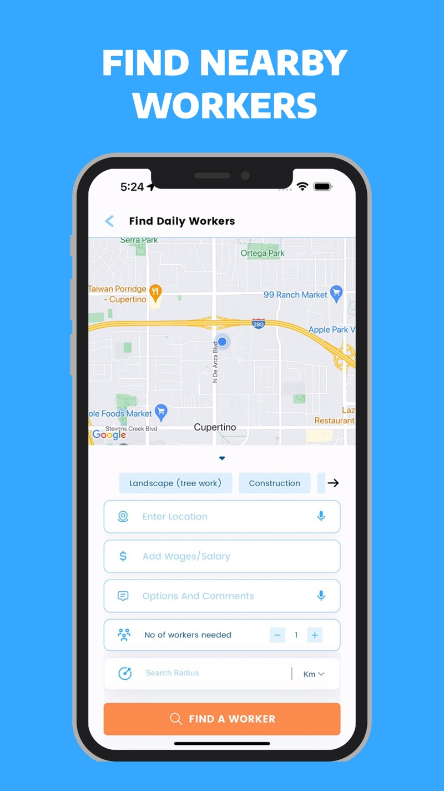

# MiPloy

**Trabajo y talento de oficio, conectados en un mismo lugar.**

MiPloy es una plataforma orientada a conectar a trabajadores de construcción y otros oficios con contratistas que buscan personal en Estados Unidos, con especial atención a la comunidad hispana. Su propuesta reúne búsqueda por ubicación, perfiles, comunicación, registro de horas y gestión de pagos.

> **Sobre este repositorio:** contiene un **sitio web estático bilingüe** y un **dossier de marca, producto y marketing**. **No incluye el código fuente de la aplicación móvil** ni una API o plataforma de pagos funcional.



## Contenido del proyecto

### Sitio web

El directorio [`sitio/`](sitio/) contiene una propuesta web adaptable a dispositivos móviles, con contenido en **español e inglés**, centrada en dos recorridos:

- **Trabajadores:** conocer oportunidades de oficios cercanas, perfiles, registro de jornada y flujo de pagos descrito por la marca.
- **Contratistas:** entender cómo publicar oportunidades, revisar perfiles, contactar trabajadores y organizar una cuadrilla.

Incluye las siguientes páginas:

| Página | Archivo |
| --- | --- |
| Inicio | [`sitio/index.html`](sitio/index.html) |
| Para trabajadores | [`sitio/trabajadores.html`](sitio/trabajadores.html) |
| Para contratistas | [`sitio/contratistas.html`](sitio/contratistas.html) |
| Cómo funciona | [`sitio/como-funciona.html`](sitio/como-funciona.html) |
| Contacto | [`sitio/contacto.html`](sitio/contacto.html) |
| Privacidad | [`sitio/privacidad.html`](sitio/privacidad.html) |
| Términos | [`sitio/terminos.html`](sitio/terminos.html) |

**Tecnologías:** HTML5, CSS3 y JavaScript nativo, sin dependencias de compilación ni framework.

El sitio ofrece menú adaptable, selector de idioma ES/EN y un formulario de contacto que prepara un correo con `mailto:`. **El formulario no envía información a un servidor.** La preferencia de idioma se guarda en el navegador cuando `localStorage` está disponible. Algunas imágenes y tipografías se cargan desde servicios externos y requieren conexión.

### Documentación de la marca

| Documento | Descripción |
| --- | --- |
| [`marca.md`](marca.md) | Misión, visión, públicos, tono, propuesta de valor e identidad visual. |
| [`producto.md`](producto.md) | Funciones de la aplicación para trabajadores y contratistas, registro, pagos e historial de versiones conocido. |
| [`redes-y-competencia.md`](redes-y-competencia.md) | Presencia digital, auditoría de redes y panorama competitivo. |
| [`estrategia.md`](estrategia.md) | Objetivos de comunicación, FODA, contenidos y planificación del briefing. |
| [`hallazgos.md`](hallazgos.md) | Diferencias y datos pendientes de verificar entre el briefing y otras fuentes. |
| [`script-reel-te-faltan-dos-personas.md`](script-reel-te-faltan-dos-personas.md) | Guion para reel de comunicación. |
| [`script-reel-te-faltan-tres-personas.md`](script-reel-te-faltan-tres-personas.md) | Variante del guion para reel. |
| [`fuentes/BRIEFING FINAL - MiPLOY.docx`](fuentes/BRIEFING%20FINAL%20-%20MiPLOY.docx) | Briefing original utilizado como fuente del dossier. |

La revisión y recopilación documental registrada en los archivos corresponde al **13 de octubre de 2026**. Las cifras y afirmaciones citadas representan las fuentes y fechas indicadas en cada documento; no son métricas actualizadas en tiempo real.

## Ejecutar el sitio localmente

**Opción 1 — Abrir el archivo:** abre [`sitio/index.html`](sitio/index.html) en un navegador.

**Opción 2 — Servidor local (recomendado):** desde la raíz del repositorio ejecuta:

```bash
cd sitio
python -m http.server 8000
```

Visita `http://localhost:8000` en tu navegador. Necesitas Python 3 para esta segunda opción.

No es necesario instalar paquetes de Node.js ni configurar variables de entorno.

## Estructura de archivos

```text
MiPloy/
├── README.md
├── marca.md
├── producto.md
├── redes-y-competencia.md
├── estrategia.md
├── hallazgos.md
├── script-reel-te-faltan-dos-personas.md
├── script-reel-te-faltan-tres-personas.md
├── fuentes/
│   └── BRIEFING FINAL - MiPLOY.docx
└── sitio/
    ├── index.html
    ├── trabajadores.html
    ├── contratistas.html
    ├── como-funciona.html
    ├── contacto.html
    ├── privacidad.html
    ├── terminos.html
    ├── css/estilos.css
    ├── js/sitio.js
    └── img/
        ├── app/
        └── obra/
```

## Enlaces de referencia

- [Sitio de MiPloy](https://miploy.com/)
- [MiPloy en App Store](https://apps.apple.com/us/app/miploy/id6476468283)
- [Instagram](https://www.instagram.com/miployapp)
- [Facebook](https://www.facebook.com/MiployOfficial)

Los enlaces externos se incluyen como referencia. Su disponibilidad y contenido pueden cambiar.

## Consideraciones antes de publicar

Este repositorio reúne materiales de desarrollo web y documentación de trabajo. Antes de utilizar su contenido como comunicación comercial vigente, valida con la marca las **cifras de usuarios y empresas, cobertura geográfica, condiciones de cobro, disponibilidad por plataforma y textos legales**. Las diferencias detectadas se explican en [`hallazgos.md`](hallazgos.md).

**Aviso de publicación:** la carpeta `fuentes/` contiene el briefing original y los documentos de estrategia pueden contener información operativa de la marca. Al usar un repositorio público, cualquier persona podrá acceder a esos archivos. Verifica que su difusión esté autorizada.

**Licencia:** este paquete no contiene un archivo `LICENSE`; no se declara aquí una licencia de reutilización de código, textos, fotografías o marcas de terceros.